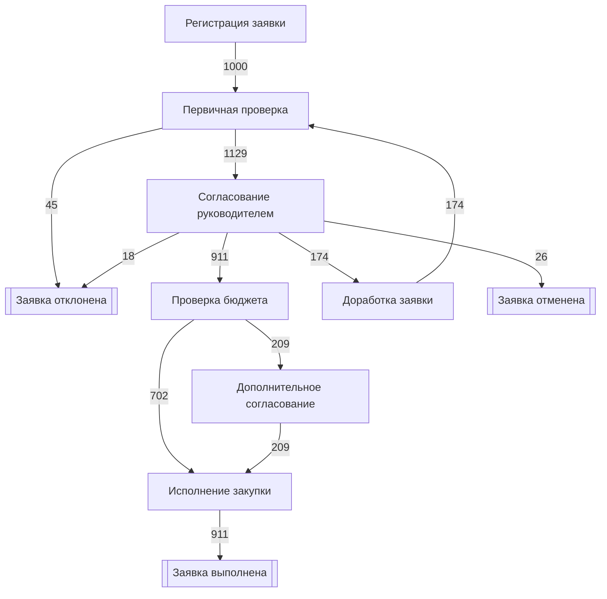

# Наблюдаемая схема процесса закупки

Числа на стрелках — количество переходов между соседними событиями, а не число разных заявок. Узлы — названия активностей из журнала; три конечных узла обозначены двойной рамкой. Стрелки показывают наблюдаемый порядок, а не доказанные внутренние шлюзы или условия их работы.

Граф объединяет переходы разных историй и допускает комбинации и количество повторов, которых в данных не было. Точный набор наблюдаемых полных маршрутов — в `variants.csv`.
